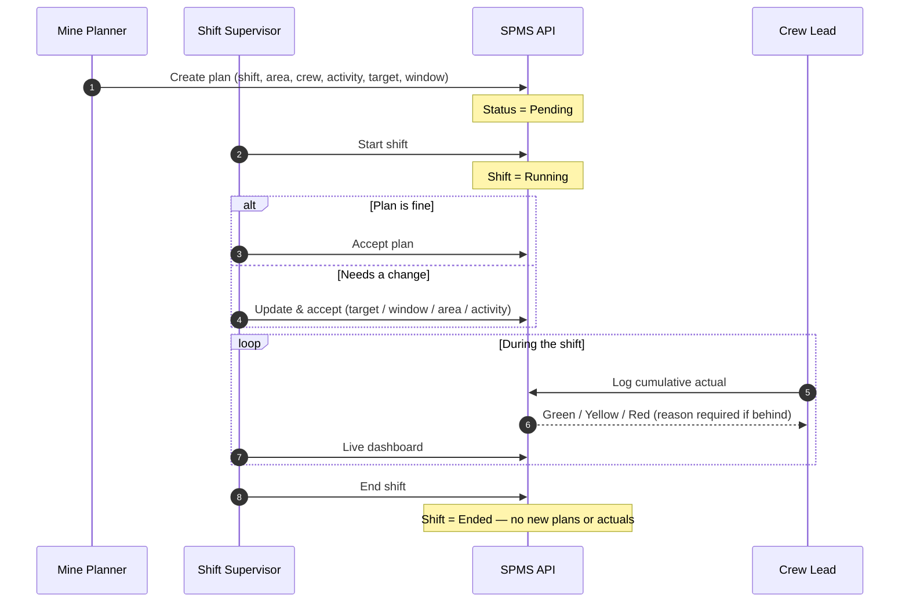
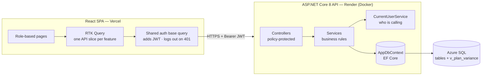
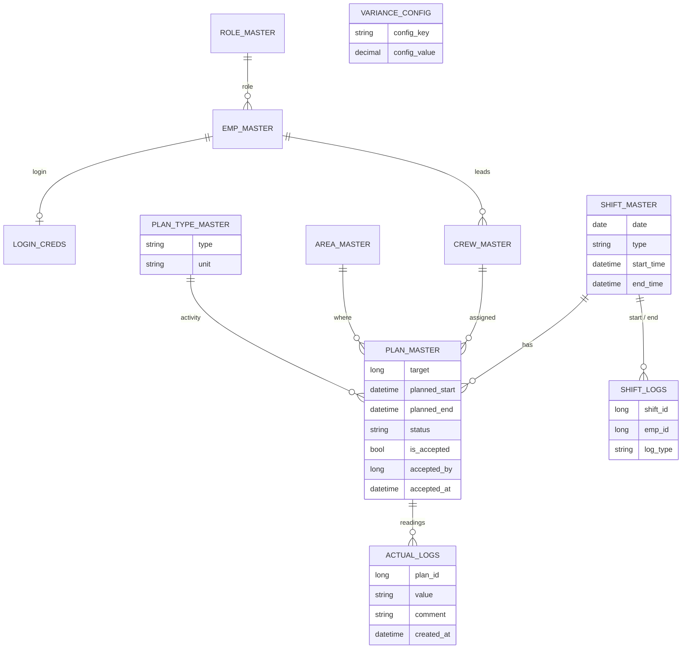

<div align="center">

# ⛏️ Shift Production Management System (SPMS)

**A full-stack showcase project built to demonstrate production-grade patterns in React, ASP.NET Core, and MSSQL** — modeled on a real industry problem: tracking shift production against plan in real time for underground and open-pit mining operations.

[**🌐 Live Demo**](https://shift-production-management-system.vercel.app) · [Architecture](#%EF%B8%8F-architecture) · [Variance Engine](#-the-variance-engine) · [API](#-api-reference) · [Run Locally](#-running-locally)


</div>

---

Rather than a generic CRUD demo, this project focuses on the kind of decisions a real ops team actually needs:

- 🔐 **Role-based access** — four mining roles, enforced by server-side authorization policies *and* role-aware UI
- ⏱️ **A real shift lifecycle** — plans are created, the shift is started, plans are accepted, actuals are logged, the shift is ended; each step is gated by state
- 📊 **Live plan-vs-actual variance** — expected-vs-actual pacing, Green / Yellow / Red / Stale status and projected end-of-shift, computed in SQL with thresholds stored in a config table
- 🧾 **Accountability on every record** — who created, accepted, updated or logged anything, and when; soft deletes only
- 🧱 **A JWT-secured API with a properly layered service/DTO architecture**, CI on every push, and a live cloud deployment

**Stack:** React (Vite) · ASP.NET Core Web API · Entity Framework Core · MSSQL · JWT authentication

---

## 💡 Why this exists

In underground and open-pit mining, every shift runs on a plan: which crew works which heading, how many metres get drilled, how many tonnes get mucked. In many operations that plan still lives on a whiteboard in the lineup room, changes happen over the radio, and the real numbers only surface at shift change — too late to recover a bad shift.

SPMS is built around **short-interval control**: make the plan explicit, make every change accountable, and capture actuals during the shift so a supervisor sees a crew falling behind *while there's still time to act*.

| Typical shift today | With SPMS |
|---|---|
| Lineup plan on a whiteboard or paper sheet | Plans per **shift, area, crew and activity type**, with a numeric target and unit (m, t, holes…) and a planned time window |
| Plans changed underground with no record of why | Supervisor **accepts** or **updates-and-accepts** each plan; status moves `Pending → Accepted / Updated`, stamped with who and when |
| Actuals reconstructed from memory at shift change | Crew leads log **cumulative readings** during the shift; falling behind without a reason is not allowed |
| "How did last shift go?" answered by word of mouth | Supervisor dashboard shows the **current shift plus the two before it** for handover |
| Shared logins, no accountability | Per-employee login, BCrypt-hashed passwords, JWT role claims, audit columns on every table |

---

## 👷 Roles & Shift Lifecycle

| Role | What they do |
|---|---|
| **Admin** | Manages employees, crews, areas and plan (activity) types; can do everything a planner or supervisor can |
| **Mine Planner** | Creates plans for upcoming shifts and tracks their status |
| **Shift Supervisor** | Starts the shift, accepts or adjusts each plan, watches live variance, ends the shift |
| **Crew Lead** | Sees only their crew's accepted plans for the running shift and logs actuals |



**Rules the API enforces**

- Shifts are `Morning`, `Afternoon` or `Night` per date, and are created automatically the first time a plan targets them.
- One plan per **crew + area + activity** per shift — duplicates are rejected.
- No new plans once a shift has **ended**. A supervisor creating a plan during a **running** shift has it accepted automatically.
- Plans can only be accepted while the shift is **running**, and only once.
- Actuals can only be logged by the **lead of the assigned crew**, on an **accepted** plan, while the shift is **running**, and not before the plan's start time.
- Readings are **cumulative**. A reading lower than the previous one needs a comment; a reading that leaves the crew in **Yellow or Red** is rolled back until a reason is given.

---

## 📊 The Variance Engine

Variance is calculated in the SQL view `v_plan_variance` ([`database/001_plan_status_and_variance_view.sql`](database/001_plan_status_and_variance_view.sql)), so the API, dashboard and any future reporting tool read the same numbers.

**Expected progress** assumes a linear pace across the plan window:

```
expected = target × (time elapsed ÷ plan length)      // capped at target after the window ends
variance = actual − expected
variance % = variance ÷ expected × 100
projected end = actual ÷ time elapsed × plan length   // shown once the plan has run long enough
```

**Status**

| Status | Rule (default thresholds) |
|---|---|
| 🟢 **Green** | On pace, or behind by **5 % or less** |
| 🟡 **Yellow** | Behind by more than 5 %, up to 15 % |
| 🔴 **Red** | Behind by more than **15 %** |
| ⚪ **Stale** | No reading for **60 minutes** while the plan window is still open |
| — | `Awaiting acceptance` / `Not started` before the plan is live |

Every threshold — Yellow %, Red %, stale minutes, warm-up periods before % and projections are shown, and a time-zone offset — lives in the **`variance_config` table**, never in code. Ops can tune them without a deployment.

---

## 🖥️ Screens

Each role signs in to a home page built for them, and the side menu only shows what that role may use.

| Screen | Who | What it shows |
|---|---|---|
| **Supervisor dashboard** | Supervisor, Admin | Current shift's plans with live variance, summary counts (Green / Yellow / Red / Stale / Pending), and the previous two shifts for handover |
| **Planner home** | Mine Planner | Plans created and their acceptance status |
| **Crew lead home / Actuals** | Crew Lead | Accepted plans for the running shift, with an entry form for readings |
| **Create Plan** | Planner, Supervisor, Admin | Assign a target and time window to a crew, area and activity |
| **My Plans** | Planner, Supervisor, Admin | Plans you created, with status and who accepted them |
| **Shift** | Supervisor, Admin | Start / end the shift; accept or update-and-accept each plan |
| **Admin Panel** | Admin | Employees, crews, areas and plan types |

<!-- 📸 Add screenshots here, e.g.  -->

---

## 🧱 Tech Stack

| Layer | Technology |
|---|---|
| **Frontend** | React 19, Vite 8, Material UI 9 (data grid, charts, date pickers), Redux Toolkit + RTK Query, React Router 7, Day.js |
| **Backend** | ASP.NET Core 8 Web API, C#, policy-based authorization |
| **Data** | Entity Framework Core 8, SQL Server / Azure SQL, SQL view for variance |
| **Auth** | JWT bearer tokens (8-hour lifetime — one shift), BCrypt password hashing |
| **DevOps** | GitHub Actions CI, Docker, Vercel (frontend), Render (API), Azure SQL (database) |
| **Tooling** | Visual Studio 2022 solution, Swagger / OpenAPI, ESLint, .NET user secrets |

---

## 🏗️ Architecture



- **Thin controllers, rules in services.** Controllers map HTTP to service calls; services own validation and return `(result, error)` so every failure comes back as a clear message.
- **Authorization in one place.** Role names and policies (`PlanCreate`, `ShiftManage`, `ActualsLog`) are defined once in `AccessRules.cs`; role matching ignores case and spacing.
- **Fail fast on bad config.** The API refuses to start if the JWT key is missing or shorter than 32 characters, the connection string is a placeholder, or CORS origins aren't set.
- **Atomic actuals.** Logging an actual saves, checks the resulting variance and rolls back inside an EF execution-strategy transaction if a reason is required.

---

## 🗄️ Data Model

Every table inherits audit and soft-delete columns from `BaseEntity`:
`created_at/by · updated_at/by · is_updated · is_deleted · deleted_at/by`



Shift state (`NotStarted / Running / Ended`) is derived from the latest `ShiftStart` / `ShiftEnd` entry in `shift_logs`, so the full history of every shift is kept.

---

## 🔌 API Reference

All routes follow `api/[controller]/[action]`. Every endpoint except login requires `Authorization: Bearer <token>`. Full schemas are in Swagger at `/swagger` (development).

| Area | Endpoints | Access |
|---|---|---|
| **Auth** | `POST /api/Auth/Login` | Public |
| **Plan** | `POST CreatePlan` · `GET GetMyPlans` | Planner, Supervisor, Admin |
| | `POST AcceptPlan` · `POST UpdateAndAccept` | Supervisor, Admin |
| **Shift** | `GET Overview` · `GET Dashboard` · `POST Start` · `POST End` | Supervisor, Admin |
| **Actuals** | `GET GetMyPlans` · `POST Log` | Crew Lead |
| **Employee** | `GET GetAllEmployees` · `POST CreateEmployee` · `POST UpdateEmployee` | Signed in |
| **Crew** | `GET GetAllCrews` · `GET GetCrewLeads` · `POST CreateCrew / UpdateCrew / DeleteCrew` | Signed in |
| **Area** | `GET GetAllArea` · `POST CreateArea / UpdateArea` | Signed in |
| **Plan type** | `GET GetAllPlanTypes` · `POST CreatePlanType / UpdatePlanType / DeletePlanType` | Signed in |
| **Role** | `GET GetAllRoles` | Signed in |

<details>
<summary><b>Example — log an actual</b></summary>

```http
POST /api/Actuals/Log
Authorization: Bearer eyJhbGciOi...

{ "planId": 42, "value": 31.5, "readingTime": "2026-10-12T10:30:00Z", "comment": null }
```

```json
{
  "saved": false,
  "reasonRequired": true,
  "message": "You are behind plan: Red (-22%). Add the reason, then save again.",
  "status": "Red"
}
```
</details>

---

## 🚀 Running Locally

### Prerequisites

[.NET 8 SDK](https://dotnet.microsoft.com/download/dotnet/8.0) · [Node.js 22](https://nodejs.org/) · SQL Server or SQL Server Express · Visual Studio 2022 (optional)

### 1. Database

Create a database named `SPMSDB`, then run the scripts in [`database/`](database/) in order. Seed the lookup tables:

```sql
INSERT INTO role_master (role, is_active, is_deleted) VALUES
  ('Admin',1,0), ('MinePlanner',1,0), ('ShiftSupervisor',1,0), ('CrewLead',1,0);
INSERT INTO area_master (area_name, is_deleted) VALUES
  ('4200L - Heading 12',0), ('4400L - Stope 7',0), ('Surface - ROM Pad',0);
INSERT INTO plan_type_master (type, unit, is_deleted) VALUES
  ('Development Drilling','m',0), ('Mucking','t',0), ('Ground Support - Bolting','bolts',0);
```

### 2. API secrets

Secrets never live in `appsettings.json`. Set them once with user secrets:

```bash
cd SPMS.Server
dotnet user-secrets set "ConnectionStrings:DefaultConnection" "Server=localhost\\SQLEXPRESS;Database=SPMSDB;Trusted_Connection=True;TrustServerCertificate=True;"
dotnet user-secrets set "Jwt:Key" "<random string, at least 32 characters>"
```

### 3. Client environment

Create `spms.client/.env.development`:

```
VITE_API_URL=https://localhost:7201
```

### 4. Run

```bash
# API — Swagger at https://localhost:7201/swagger
cd SPMS.Server && dotnet run --launch-profile https

# Client — http://localhost:5173
cd spms.client && npm install && npm run dev
```

Or open `SPMS.sln` in Visual Studio and start both projects.

### 5. First sign-in

Sign in with employee number **`000`** — a bootstrap admin used only to create the first real users. In development no password is needed; in any other environment it only works when `Auth:BootstrapAdminPassword` is set. New employees get a starter password of **`<FirstName><EmployeeNumber>`** (e.g. `Jane007`).

---

## ☁️ Deployment

| Piece | Where | How |
|---|---|---|
| **Frontend** | Vercel | Builds `spms.client`; `VITE_API_URL` points at the API |
| **API** | Render | Multi-stage `Dockerfile` (SDK build → ASP.NET runtime on port 10000) |
| **Database** | Azure SQL | Same scripts as local |
| **CI** | GitHub Actions | Every push to `main` runs `npm ci && npm run build` for the client and `dotnet build` for the API |

Production config comes from environment variables: `ConnectionStrings__DefaultConnection`, `Jwt__Key`, `Cors__AllowedOrigins__0`, `ASPNETCORE_ENVIRONMENT=Production`.

> ℹ️ The API runs on Render's free tier, so the first request after a quiet period can take up to a minute while it wakes up.

---

## 📁 Project Structure

```
SPMS/
├── .github/workflows/ci.yml      # Client + API build on every push
├── Dockerfile                    # API container for Render
├── database/                     # Versioned SQL scripts (status, variance view, config)
├── SPMS.Server/                  # ASP.NET Core 8 Web API
│   ├── Controllers/              # Auth, Plan, Shift, Actuals, Employee, Crew, Area, PlanType, Role
│   ├── Services/                 # Business rules + AccessRules.cs (roles, policies, shift rules)
│   ├── Models/                   # EF entities (BaseEntity audit columns) + PlanView
│   ├── DTOs/                     # Request / response contracts
│   └── Data/AppDbContext.cs      # Table, column and view mappings
└── spms.client/                  # React 19 + Vite
    └── src/
        ├── app/                  # Redux store, auth base query, config, shift helpers
        ├── features/             # RTK Query API slice per feature + auth slice
        ├── dashboard/            # Role-based home pages and supervisor dashboard
        ├── plan/                 # Create Plan, My Plans, Shift management
        ├── actuals/              # Crew lead actuals entry
        ├── admin-panel/          # Employees, crews, areas, plan types
        └── theme/                # Material UI theme and component styling
```

---

## 🔐 Security

- Passwords hashed with **BCrypt**; never stored or returned in plain text.
- JWTs validated for issuer, audience, signature and lifetime; expire after one shift (8 h).
- **Policy-based authorization** on plan, shift and actuals endpoints; the client logs the user out on any `401`.
- Every write is attributed from the token's claims — never from IDs sent by the client.
- Secrets live in user secrets (dev) and environment variables (prod); the API won't start without them.
- CORS restricted to configured origins per environment.

---

## 🧭 Roadmap

- [ ] Restrict admin endpoints (employees, crews, areas, plan types) to the Admin role on the server
- [ ] Multi-role support — an employee ↔ role mapping so one person can hold several roles
- [ ] Effective-dated role and crew assignment history (schema groundwork in `crew_assignment`)
- [ ] Delay / downtime codes and equipment assignment per plan
- [ ] Shift handover notes between outgoing and incoming supervisors
- [ ] Automated tests for services and the variance view
- [ ] EF Core migrations to replace hand-run SQL scripts

---

## 👤 Author

**Rony Parmar** — Full Stack Developer · Sudbury, Ontario
React · .NET / C# · SQL Server · Node.js · MongoDB

[GitHub](https://github.com/Ronyparmar2107) · ronyparmar2107@gmail.com

---

<div align="center"><sub>Plan the shift. Own the changes. Know the numbers before shift change.</sub></div>
